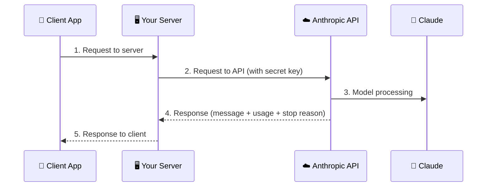

# 📘 My AI & Claude Study Notes

Short, simple notes for quick revision. Each topic has everything in one place: **key points → code → quiz answers**.

> **TL;DR:** Brief Claude like a colleague → **Task + Context + Example + Format** → iterate.

## 📚 Contents
**Part A – AI & Claude Basics** ([Claude 101](https://anthropic.skilljar.com/claude-101))
1. [AI Basics](#1-ai-basics)
2. [How an LLM Works](#2-how-an-llm-works)
3. [Claude Features & Where Claude Lives](#3-claude-features--where-claude-lives)
4. [AI Tools Map](#4-ai-tools-map)
5. [AI Safety](#5-ai-safety)

**Part B – Building with the Claude API** ([course](https://academy.claude.com/courses/building-with-the-claude-api))
6. [API Basics](#6-api-basics)
7. [Prompt Engineering](#7-prompt-engineering)
8. [Prompt Evaluation](#8-prompt-evaluation)
9. [Tool Use](#9-tool-use)
10. [RAG (Search in Documents)](#10-rag-search-in-documents)
11. [Claude Features (API)](#11-claude-features-api)
12. [MCP (Model Context Protocol)](#12-mcp-model-context-protocol)
13. [Claude Code & Computer Use](#13-claude-code--computer-use)
14. [Agents & Workflows](#14-agents--workflows)

**Part C – System Design**
15. [System Design Basics](#15-system-design-basics)

**[⚡ One-Page Cheat Sheet](#-one-page-cheat-sheet)**

---

# Part A – AI & Claude Basics

## 1. AI Basics

| Term | Simple meaning |
|---|---|
| **AI Operators** | Companies that **build** AI models (OpenAI, Anthropic, Google) |
| **AI Builders** | People who **use** AI to build apps and automate work |
| **GenAI** | AI that **creates** text, images, audio, video, code |
| **AI Agent** | AI that **takes action** to reach a goal (writes code, makes files), not just a chatbot |
| **Automation** | **Fixed steps:** Trigger → Action → Output |
| **Autonomous** | Give only a **goal**; AI decides the steps |

**How models learn**
- **SFT (Supervised Fine-Tuning)** → learns from labeled examples
- **RL (Reinforcement Learning)** → learns by trial and error with rewards (e.g. DeepSeek-R1, strong at coding)

---

## 2. How an LLM Works

```
Input text → Tokenize → Embed → Contextualize → Generate next word → repeat → Decode to words
```

| Step | Simple meaning |
|---|---|
| **1. Tokenize** | Split text into **tokens** (a word, part of a word, space or symbol). 5 words ≠ always 5 tokens. |
| **2. Embed** | Each token → a **list of numbers** holding all its possible meanings. Example: "quantum" = physics unit, very small, quantum computing… |
| **3. Contextualize** | Uses **nearby words** (self-attention) to pick the right meaning |
| **4. Generate** | Calculates the probability of every next word, picks one (**probability + a bit of randomness**), adds it, and **repeats** |
| **5. Decode** | Turns tokens back into words |

**When does Claude stop?** After every token it checks:
| Condition | Meaning |
|---|---|
| **Max tokens** | Hit the limit you set |
| **End-of-sequence token** | Natural ending |
| **Stop sequence** | Found a stop phrase you defined |

**Limits & cost**
- No live access (calendar, APIs) on its own → fix with **agents + connectors/tools**
- **More tokens = more cost** → skip filler words

---

## 3. Claude Features & Where Claude Lives

**Features in the Claude app**
| Feature | Simple meaning |
|---|---|
| **Projects** | Workspace with saved files + instructions |
| **Artifacts** | Finished outputs: docs, apps, slides, diagrams |
| **Skills** | Reusable workflows for repeated tasks |
| **Connectors (MCP)** | Bring in data from your tools (Drive, Gmail, Slack, M365) |
| **Enterprise search** | Search all company tools at once |
| **Research** | Deep reports with citations |
| **Memory** | Remembers past chats |

**Where Claude lives**
- Web · Desktop · Mobile
- **Claude Code** → coding · **Cowork** → desktop tasks
- Chrome · Excel · PowerPoint
- Slack via **Claude Tag**

---

## 4. AI Tools Map

| Need | Tool |
|---|---|
| Chat assistant | Claude, ChatGPT, Gemini |
| Coding | Claude Code, Cursor (Agent / Plan / Debug / Ask), Gemini CLI, GitHub Copilot |
| Research & study | NotebookLM → audio/video overview, mind map, flashcards, quiz |
| Images | Midjourney |
| Voice | ElevenLabs → text-to-speech, voice cloning |
| Speech-to-text | Whisper (OpenAI) |
| Video | OpenArt |
| UI / apps from a prompt | v0.dev → React, Next.js, Tailwind |
| Live web data | SearchAPI → REST API for chatbots, RAG, n8n |
| Automation | n8n (self-host), Make, Zapier |
| Autonomous agent | Manus |

**n8n on Google Cloud (free)**
1. Create an e2-micro VM
2. Install Docker + Compose
3. Run n8n with `docker-compose.yml`
4. Add Nginx/Caddy + SSL
5. Open it on your domain

---

## 5. AI Safety

- **Jailbreak** → tricking AI past its rules (prompt injection, roleplay)
- **Stay safe** → ground answers with **RAG**, add **human review** and **ethical checks**

---

# Part B – Building with the Claude API

## 6. API Basics

> 🧠 **Remember:** "**K**ind **M**onkeys **M**ake **M**agic" = **K**ey, **M**odel, **M**essages, **M**ax tokens

### The 5-step request flow


**Why a server?** If the API key is in client code, **anyone can steal it**. So: client → **your server (holds key)** → Anthropic API.

| Topic | Simple meaning |
|---|---|
| **SDKs** | Python, TypeScript, JavaScript, Go, Ruby (or plain HTTP) |
| **API Key** | Secret password. Keep it **on the server** in a `.env` file |
| **Request** | Needs 4 things: **key, model, messages, max_tokens** |
| **Response** | **Message** (text) + **Usage** (input/output tokens) + **Stop reason** (why it ended) |
| **Multi-turn** | Claude has **no memory**. Send the **full chat history** every time |
| **System prompt** | Sets Claude's **role and rules** |
| **Temperature** | **0.0** = predictable (facts, code). **1.0** = creative (stories) |
| **Streaming** | Shows the reply **word by word** |
| **Structured data** | Clean JSON with **prefill** (start) + **stop sequence** (end) |

```python
import anthropic
client = anthropic.Anthropic()          # reads ANTHROPIC_API_KEY

response = client.messages.create(
    model="claude-sonnet-5-5",
    max_tokens=1000,
    system="You are a math tutor. Give hints, not answers.",
    messages=[{"role": "user", "content": "Hi"}]
)
print(response.content[0].text)
```

**Clean JSON trick**
```python
messages=[
    {"role": "user", "content": "Give user data as JSON"},
    {"role": "assistant", "content": "```json"}   # prefill = start
],
stop_sequences=["```"]                             # stop = end
```

**✅ Quiz answers**
- 4 things in every request → **API key, model, messages, max tokens**
- Where to keep the API key → **On your server**, never in JavaScript, GitHub or the browser
- Claude forgot the earlier question → **Send the whole conversation history**
- Tutor that gives hints → **System prompt**
- Very creative stories → **Temperature 1.0**

---

## 7. Prompt Engineering

> 🧠 **Remember:** "**C**ats **S**leep **X**tra **E**arly" = **C**lear, **S**pecific, **X**ML, **E**xamples

| Technique | Rule | Example |
|---|---|---|
| **Clear & Direct** | Start with an **action verb** | ❌ "What workout should I do?" ✅ "Create a workout plan" |
| **Specific** | Add length, audience, format, steps | "30-minute plan for beginners, no equipment" |
| **XML Tags** | Separate **data** from **instructions** | `<email>...</email>` |
| **Examples** | Show input → output pairs (one-shot / multi-shot) | Best for tricky things like sarcasm |

```xml
Summarize the email below in 2 sentences.
<email>
Hi team, the meeting moved to Friday...
</email>
```

### Everyday prompting in the Claude app: T-C-E-F
- **T**ask – what you want
- **C**ontext – who, why, constraints
- **E**xample – show the style you like
- **F**ormat – length, tone, layout
- Iterate with short feedback: "shorter", "add a table"
- Hard problem → "think step by step" · Unsure → "ask me questions first"

⚠️ Prompt engineering does **not** train the model. XML tags do **not** make Claude faster.

**✅ Quiz answers**
- Clearest prompt → **"Write a product description for running shoes."**
- Reviews + sales data in one prompt → **XML tags `<reviews>` and `<sales_data>`**

---

## 8. Prompt Evaluation

> 🧠 **Remember:** "**D**ogs **T**ake **R**ed **G**ifts **R**epeatedly" = **D**raft → **T**est data → **R**un → **G**rade → **R**epeat

**Engineering = improve** a prompt. **Evaluation = measure** it.
⚠️ Testing only once is risky. Real users send unexpected inputs.

```
1. Draft a prompt
2. Create a test dataset    ← use a cheap model like Haiku; add edge cases
3. Run each input through Claude
4. Grade the responses      ← right after running
5. Improve → repeat → compare scores
```

| Grader | Who checks | Good for |
|---|---|---|
| **Code** | A program | Valid JSON, length, keywords |
| **Model** | AI (Claude) | Quality, clarity, tone |
| **Human** | A person | Most accurate, but slow |

💡 Model grader: ask for **strengths, weaknesses and reasoning first, score last**.

```python
results = []
for test in dataset:
    output = run_prompt(test)
    results.append(grade(test, output))
print("Average:", sum(results) / len(results))
```

**✅ Quiz answers**
- Measure how well a prompt works → **Prompt evaluation with automated testing**
- Step after getting responses → **Send them to a grader**
- Model grader → **Another AI model that scores quality**
- After changing a prompt → **Run the eval again**

---

## 9. Tool Use

> 🧠 **Remember:** "**I**n **T**he **D**ark **F**orest" = **I**nitial request → **T**ool request → **D**ata retrieval → **F**inal response

**Why tools?** Claude only knows its training data. Tools give **real-time info** and **outside systems**.

```
Claude asks (tool_use) → Your code runs it → You send tool_result → Claude answers
```

| Part | Simple meaning |
|---|---|
| **Tool function** | A normal Python function that does the work |
| **Tool schema** | JSON with the tool's **name, purpose, inputs** |
| **Message blocks** | Reply can have **text + tool_use** together |
| **tool_result** | Send back with the **same id** |
| **Loop** | Repeat while `stop_reason == "tool_use"`; `"end_turn"` = done |
| **Multiple tools** | Claude **picks the right one** |
| **Batch tool** | Many calls in **one request** = fewer round trips |
| **Fine-grained** | Streams tool inputs piece by piece (JSON may be incomplete) |
| **Text editor tool** | Built-in schema, **you write** the file code |
| **Web search tool** | Built-in, **Anthropic runs it** |

```python
def get_weather(city):                       # tool function
    return f"18°C, sunny in {city}"

tool_schema = {                              # tool schema
  "name": "get_weather",
  "description": "Get current weather for a city",
  "input_schema": {
    "type": "object",
    "properties": {"city": {"type": "string"}},
    "required": ["city"]
  }
}

while response.stop_reason == "tool_use":    # the loop
    result = run_tool(response)
    response = send_result_back(result)
```

**✅ Quiz answers**
- Purpose of tools → **Real-time info and outside systems**
- Tool function → **A plain function run when Claude needs it**
- Text + tool_use in one reply → **Multi-block message**
- Batch tool → **Runs many tool calls together**

---

## 10. RAG (Search in Documents)

> 🧠 **Remember:** "**C**ut, **C**ode, **S**tore, **F**ind, **F**eed" = Chunk → Embed → Store → Find → Feed to Claude

**RAG = open-book exam.** Give Claude only the useful parts of a big document.

| Term | Simple meaning |
|---|---|
| **Chunking** | Cut documents into pieces (by size, headings, or sentences). Use **overlap**. |
| **Embedding** | Text → numbers capturing **meaning** ("dog" ≈ "puppy"). Compare with **cosine similarity**. |
| **Vector DB** | Stores the embeddings |
| **BM25** | **Keyword** search for **exact words** (IDs, codes). Rare words count more. |
| **Hybrid search** | Embeddings + BM25 merged = **meaning + exact words** |

```
SETUP:   Document → Chunk → Embed → Store
ASK:     Question → Embed → Find closest chunks
ANSWER:  Question + chunks → Claude → Answer
```

---

## 11. Claude Features (API)

> 🧠 **Remember:** "**T**iny **I**guanas **P**lay **C**hess, **C**limb **C**liffs" = Thinking, Images, PDFs, Citations, Caching, Code execution

| Feature | What it does | Key code |
|---|---|---|
| **Extended thinking** | Thinks step by step first | `thinking={"type": "enabled", "budget_tokens": 2000}` |
| **Images** | Send an image as base64 | `"type": "image"` |
| **PDFs** | Reads text, tables, charts, images | `"type": "document"` + `"application/pdf"` |
| **Citations** | Links answers to the source to **verify** | `"citations": {"enabled": True}` |
| **Prompt caching** | Saves a big repeated prompt → **faster, cheaper** | `"cache_control": {"type": "ephemeral"}` |
| **Files API** | Upload once, reuse with `file_id` | `client.beta.files.upload(...)` |
| **Code execution** | Runs Python in a safe container, **no internet** | — |

**Caching rules**
| Rule | Value |
|---|---|
| Minimum size | ~1024 tokens (varies by model). Smaller = not cached, no error |
| Lifetime | 5 minutes (refreshes on use) |
| Max breakpoints | 4 |
| What's cached | Everything **before** the breakpoint (tools → system → messages) |
| Breaks if | Anything before the breakpoint changes |

**✅ Quiz answers**
- Verify facts from documents → **Citations**
- Same long document, many questions → **Prompt caching**

---

## 12. MCP (Model Context Protocol)

**MCP** = a standard way to connect Claude to outside tools and data **without writing all the integration code yourself**. In the Claude app, these are called **Connectors**.

```
Your App → MCP Client → MCP Server → (tools, resources, prompts)
```

| Part | Role |
|---|---|
| **MCP Server** | Holds **tools, resources, prompts** |
| **MCP Client** | The **bridge**: **your Client class + the SDK's Client Session** |
| **Transport agnostic** | Works over **stdio** (local) or **HTTP** (remote) |

**Who controls what?**
| Primitive | Controlled by | Example |
|---|---|---|
| **Tools** | **Model** | Claude calls `read_doc_contents` |
| **Resources** | **App** | App loads a document |
| **Prompts** | **User** | User clicks "Summarize document" |

- **Direct resource:** fixed URI → `docs://documents`
- **Templated resource:** `docs://documents/{doc_id}`
- `ListToolsRequest` = what tools exist? · `CallToolRequest` = run a tool

```python
@mcp.tool(name="read_doc_contents", description="Read a document")
def read_document(doc_id: str = Field(description="Id of the document")):
    return docs[doc_id]                  # SDK makes the JSON schema

@mcp.resource("docs://documents/{doc_id}")
def fetch_doc(doc_id: str) -> str:
    return docs[doc_id]
```

**Test your server:** `mcp dev mcp_server.py` → opens the **MCP Inspector**.

**✅ Quiz answers**
- What is MCP → **Communication layer for tools and context without integration code**
- Problem without MCP → **You write and maintain all tool code yourself**
- Server vs client → **Server holds tools/prompts/resources; client is the bridge**
- Transport agnostic → **HTTP or stdio**
- Easiest way to define a tool → **`@mcp.tool()` decorator**
- Test before building an app → **MCP Inspector**
- Two parts of a client → **MCP Client class + Client Session**
- Find available tools → **`ListToolsRequest`**
- Fetch a doc by ID → **Templated resource**
- User clicks a button to start a workflow → **Prompt**

---

## 13. Claude Code & Computer Use

*Includes notes from the [Claude Code 101](https://academy.claude.com/courses/claude-code-101) course.*

### What is Claude Code?
An **AI coding agent** that reads, writes and edits code and runs commands.
- **Runs in:** terminal, VS Code, JetBrains, Claude Desktop, web
- **Agentic loop:** gather context → take action → verify → repeat until done
- **Tools** = what Claude **can** do · **Permissions** = what it's **allowed** to do without asking
- **Context window** = everything Claude can see now. When full, it **auto-compacts** (summarizes older chat)

### Modes (switch with `Shift+Tab`)
| Mode | What it does | Oversight |
|---|---|---|
| **Manual** | Asks before each edit or command | Most |
| **Auto-accept** | Applies edits without asking | Less |
| **Plan Mode** | Read-only: researches and proposes a plan | Review before acting |

### Daily workflow: Explore → Plan → Code → Commit
1. **Explore** – read files and docs, no code yet
2. **Plan** – Claude proposes an approach; you review
3. **Code** – implement and verify (run tests)
4. **Commit** – commit, open a PR, update docs

**Code review:** check changes yourself, and use a **fresh-context reviewer** (new session or subagent that didn't write the code).

### Context commands
| Command | Purpose |
|---|---|
| `/compact` | Summarize the chat to free space |
| `/clear` | Start fresh |
| `/context` | Show what's using the context window |
| `/init` | Create a starter `CLAUDE.md` |

### Customizing
| Feature | Simple meaning |
|---|---|
| **CLAUDE.md** | Project memory (commands, rules, structure). Read at the start of **every session** |
| **Subagents** | Helpers with their **own context**; keep the main context clean |
| **Skills** | Reusable instructions for repeated tasks |
| **MCP servers** | Connect outside tools (databases, issue trackers, APIs) |
| **Hooks** | Scripts that run **automatically** at set points (auto-format, block commands, notify) |

### Computer Use
Claude uses a computer **like a human**: screenshots, mouse, keyboard. It gets a screenshot after every action.

**✅ Quiz answers**
- Computer Use → **Claude interacts with a desktop like a human would**

---

## 14. Agents & Workflows

**Used for tasks Claude can't finish in one request.**

| | **Workflow** | **Agent** |
|---|---|---|
| Steps | **Fixed**, decided by you | Claude **decides** |
| Use when | You **know** the steps | Task is **unknown** |
| Strength | Reliable, testable | Flexible |
| Weakness | Less flexible | Less reliable, costs more |

### Workflow patterns
| Pattern | Simple meaning | Example | Use when |
|---|---|---|---|
| **Parallelization** | Split, run **at the same time**, combine | Check a part for each material at once → pick the best | Independent checks |
| **Chaining** | Steps **one after another** | Topic → research → script → video → post | Many rules; steps depend on each other |
| **Routing** | **Sort first**, then send to **one** special prompt | "Python functions" → Educational | Many request types |
| **Evaluator-Optimizer** | **Make → check → fix → repeat** | Image → 3D model → compare → fix | Output must pass a quality bar |

💡 **Long prompt problem (Chaining fix):** Step 1, write the article. Step 2, ask Claude **only** to fix broken rules.

### Agents
- **Goal + tools**, and Claude finds the steps
- **Combines simple tools:** get time + add days + set reminder → "What day is it in 11 days?"
- **Asks for missing info:** "When does my 90-day warranty end?" → asks when you bought it
- **Keep tools general:** Claude Code uses `bash`, `read`, `write`, `edit`, `glob`, `grep`

### Environment inspection
Claude must **see the result** of each action, or it works blind.
- Computer Use → screenshot after each click
- Files → **read before write**
- Video → check captions (whisper.cpp) and screenshots (FFmpeg)

🔑 **Golden question:** "How will Claude know if this action worked?"

**✅ Quiz answers**
- Know the exact steps / reliability matters → **Workflow**
- Car damage photo → repair estimate → **Workflow with fixed steps**
- Compare many materials → **Parallelization**
- Claude ignores rules in a long prompt → **Chaining**
- Educational vs entertainment content → **Routing**
- Write → check → improve → **Evaluator-Optimizer**
- Most flexible agent tools → **Abstract tools (`read_file`, `write_file`, `run_command`)**
- Why environment inspection → **Agent sees the results of its actions**

---

# Part C – System Design

## 15. System Design Basics

**System design** = planning the parts of a system and how they work together.

**Steps:** Understand the problem → Set the scope → Study existing systems → Draw the architecture → Test, improve, document

| Concept | Simple meaning |
|---|---|
| **Performance vs Scalability** | Fast for one user vs still works with many users |
| **Latency vs Throughput** | Time for one response vs requests handled at once |
| **Availability vs Consistency** | System stays up vs data is the same everywhere (strong / weak / eventual) |

| Need | API pattern |
|---|---|
| Simple request/response | REST |
| Fetch exactly the fields you need | GraphQL |
| Fast, typed service-to-service | gRPC / tRPC |
| Real-time two-way | WebSockets |
| Server notifies you | Webhooks |
| Simple periodic check | Polling |

**Frontend performance**
- Code splitting, tree shaking, compression
- Lazy load on scroll or click, prefetch/preload, virtual lists
- **Web Vitals:** LCP (load speed), INP (response to clicks), CLS (layout jumps)

**Images:** WebP/AVIF, `srcset` / `<picture>`, `loading="lazy"`, CDN.
```html
<picture>
  <source srcset="image-1600.webp" type="image/webp">
  
</picture>
```

**Testing & monitoring:** Unit → Integration → E2E. Load tests with k6 or JMeter. Logs, metrics, tracing.

**Accessibility:** semantic HTML, ARIA, keyboard navigation, color contrast. Check with axe or Lighthouse.

📌 **To fix:** `Frontend System Design Yatra1.png` is empty (0 bytes). Re-upload the real image.

**Resources:** [System Design Roadmap](https://roadmap.sh/system-design) · [Excalidraw board](https://app.excalidraw.com/l/8lwXEYCWFUz/5BWKjqfiBK6)

---

# ⚡ One-Page Cheat Sheet

| Question | Answer |
|---|---|
| Automation vs autonomous? | Fixed steps vs AI decides the steps |
| LLM steps? | Tokenize → Embed → Contextualize → Generate → Decode |
| When does Claude stop? | Max tokens, end token, or stop sequence |
| Good chat prompt? | Task + Context + Example + Format |
| Why a server? | Keep the API key secret |
| 4 things in a request? | Key, model, messages, max_tokens |
| What comes back? | Message + usage + stop reason |
| Claude forgets? | Send full history |
| Set role/rules? | System prompt |
| Creative? / Factual? | Temp 1.0 / Temp 0.0 |
| Clean JSON? | Prefill + stop sequence |
| Improve vs measure a prompt? | Engineering vs Evaluation |
| After running eval? | Grade the responses |
| Separate data in a prompt? | XML tags |
| Tool loop check? | `stop_reason == "tool_use"` |
| Fewer tool round trips? | Batch tool |
| Exact IDs in search? / Meaning? | BM25 / Embeddings |
| Verify facts from docs? | Citations |
| Same big doc many times? | Prompt caching |
| Tools / Resources / Prompts controlled by? | Model / App / User |
| Test MCP server? | `mcp dev mcp_server.py` |
| Claude Code project memory? | `CLAUDE.md` |
| Read-only planning mode? | Plan Mode (`Shift+Tab`) |
| Free up context? | `/compact` (or `/clear` to restart) |
| Auto-run scripts in Claude Code? | Hooks |
| Known steps? / Unknown task? | Workflow / Agent |
| Same time? / Step after step? | Parallelization / Chaining |
| Sort first? / Make → check → fix? | Routing / Evaluator-Optimizer |
| Agent must see results? | Environment inspection |
