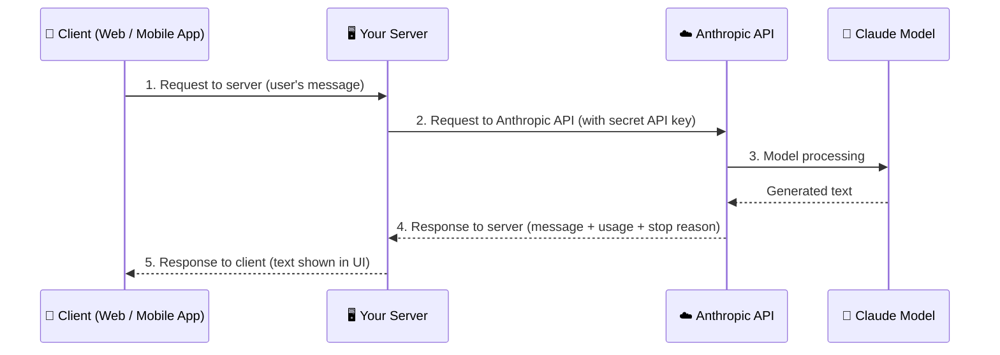
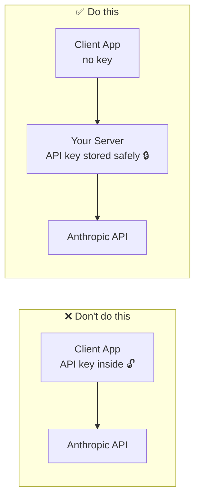
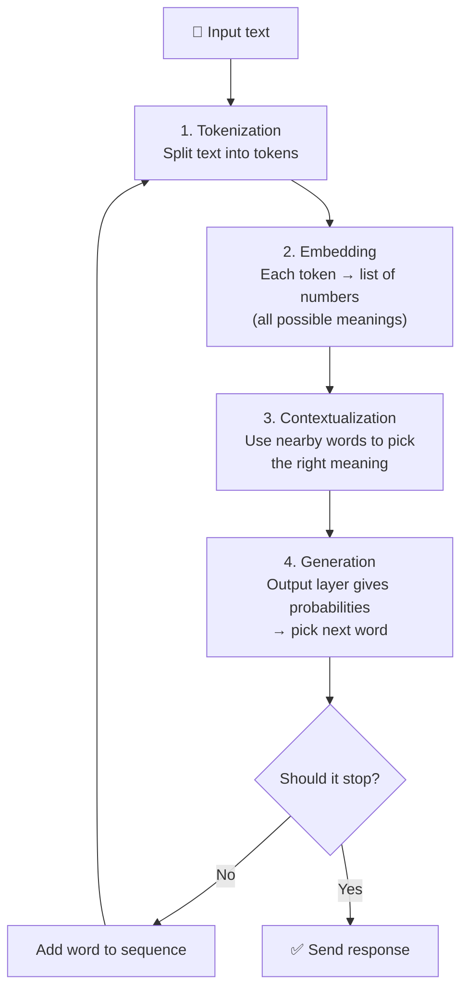
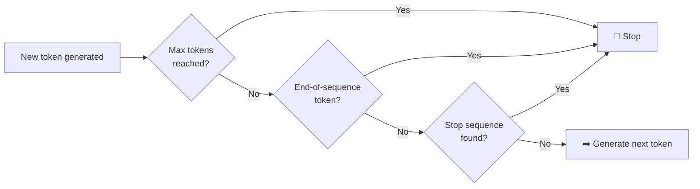

# AI & Claude Notes – README

Oct 7, 2026 · @ashish yadav

> **TL;DR:** Brief Claude like a colleague → **Task + Context + Example + Format** → iterate.

## AI basics

- **AI Operators** → build AI models (OpenAI, Anthropic, Google)
- **AI Builders** → use AI to build apps and automate
- **GenAI** → creates text, images, audio, video, code
- **AI Agent** → works on its own: writes code, makes files, acts like a human workflow
- **Automation** = fixed steps: Trigger → Action → Output
- **Autonomous** = give only a goal, AI decides the steps

## How an LLM works (5 steps)

1. **Tokenize** → text to tokens (5 words ≠ 5 tokens)
2. **Vectorize** → tokens to number vectors
3. **Self-attention** → finds context between words
4. **Predict** → next token
5. **Decode** → back to words

- **Limit:** no live access (calendar, APIs) → fix with agents + integrations/connectors
- **Cost:** more tokens = more cost → skip filler words

## How models learn

- **SFT** → learns from labeled data
- **RL** → trial and error with rewards (e.g. DeepSeek-R1, strong at coding)

## Prompting: T-C-E-F

- **T**ask – what you want
- **C**ontext – who, why, constraints
- **E**xample – show the style you like
- **F**ormat – length, tone, layout
- Iterate with short feedback: "shorter", "add a table"
- Hard problem → "think step by step"
- Unsure → "ask me questions first"

## Claude features

- **Projects** → workspace with saved files + instructions
- **Artifacts** → deliverables: docs, apps, slides, diagrams
- **Skills** → repeatable workflows
- **Connectors (MCP)** → your tools' data (Drive, Gmail, Slack, M365)
- **Enterprise search** → search all company tools at once
- **Research** → deep, cited reports
- **Memory** → remembers past chats

## Where Claude lives

- Web · Desktop · Mobile
- Claude Code → coding
- Cowork → desktop tasks
- Chrome · Excel · PowerPoint
- Slack via Claude Tag (Teams coming soon)

## AI tools map

| Need | Tool |
| --- | --- |
| Chat assistant | Claude, ChatGPT, Gemini |
| Coding | Claude Code, Cursor (Agent / Plan / Debug / Ask), Gemini CLI, GitHub Copilot |
| Research & study | NotebookLM → audio/video overview, mind map, flashcards, quiz |
| Images | Midjourney |
| Voice | ElevenLabs → text-to-speech, voice cloning |
| Speech-to-text | Whisper (OpenAI) |
| Video | OpenArt |
| UI / apps from prompt | v0.dev → React, Next.js, Tailwind |
| Live web data | SearchAPI → REST API for chatbots, RAG, n8n |
| Automation | n8n (self-host), Make, Zapier |
| Autonomous agent | Manus |

## n8n on Google Cloud (free)

1. Create e2-micro VM
2. Install Docker + Compose
3. Run n8n via `docker-compose.yml`
4. Add Nginx/Caddy + SSL
5. Open on your domain

## AI safety

- **Jailbreak** → tricking AI past its rules (prompt injection, roleplay)
- **Stay safe:** ground answers with retrieval (RAG) + human review + ethical checks

ills

Source: [Claude 101 – Anthropic Academy](https://anthropic.skilljar.com/claude-101)

# Claude Code 101 — Quick Notes

Short memorization notes for the [Claude Code 101](https://academy.claude.com/courses/claude-code-101) course on Claude Academy.

---

## 1. What is Claude Code?

- **AI agent** = AI that takes action to complete goals, not just a chatbot that answers.
- **Agentic loop:** gather context → take action → verify results, repeated until the task is done.
- **Tools** decide what Claude *can* do (read/edit files, run commands, search).
- **Permissions** decide what it's *allowed* to do without asking.
- **Context window** = everything Claude can "see" right now. When it fills up, Claude Code **auto-compacts** (summarizes older conversation).

## 2. Your First Prompt

Runs in: **terminal**, **VS Code**, **JetBrains**, **Claude Desktop**, or the **web**.

Three modes (cycle with `Shift+Tab`):

| Mode | What it does | Oversight |
|---|---|---|
| Manual / approval | Asks before each edit or command | Most |
| Auto-accept | Applies edits without asking | Less |
| Plan Mode | Read-only; researches and proposes a plan, no changes | Review before acting |

## 3. Daily Workflows

### Explore → Plan → Code → Commit

1. **Explore** — read relevant files and docs; no code yet.
2. **Plan** — Claude proposes an approach; you review and adjust.
3. **Code** — implement and verify (e.g. run tests).
4. **Commit** — commit changes, open a PR, update docs.

### Context Commands

| Command | Purpose |
|---|---|
| `/compact` | Summarize the conversation to free space (keeps key info) |
| `/clear` | Wipe the conversation and start fresh |
| `/context` | Show what's using your context window |

### Code Review

- Check changes with your own eyes.
- Use a **fresh-context reviewer** (new session or subagent that didn't write the code).

## 4. Customizing Claude Code

| Feature | What it is |
|---|---|
| **CLAUDE.md** | Project memory: commands, conventions, structure. Read automatically at the start of **every session**. `/init` creates a starter one. |
| **Subagents** | Specialized helpers with their own separate context; delegate tasks and keep the main context clean. |
| **Skills** | Reusable instructions for tasks you repeat often. |
| **MCP servers** | Connect external tools and data sources (databases, issue trackers, APIs). |
| **Hooks** | Scripts that run automatically at set points (e.g. before/after a tool runs). **Deterministic** control: auto-formatting, blocking commands, notifications. |

---

# Accessing the API — Simple Notes

**Course:** Building with the Claude API (Claude Academy)
**Lesson:** 1 of 67 · Accessing the API · ~3 min

> Goal: understand what happens from the moment a user clicks **Send** until Claude's reply shows on screen.

---

## 1. The Big Picture: 5-Step Request Flow

**The 5 steps:**
1. Request to server
2. Request to Anthropic API
3. Model processing
4. Response to server
5. Response to client

---

## 2. Why You Need a Server

- API requests need a **secret API key**.
- If the key is in client code, **anyone can extract it** and make requests on your account.
- So: **client → your server → Anthropic API**. Only the server holds the key.

---

## 3. Making an API Request

You can use an **official SDK** or **plain HTTP requests**.
SDKs available: **Python, TypeScript, JavaScript, Go, Ruby**.

### Every request needs 4 things

| Field | What it does |
|---|---|
| **API Key** | Identifies your request to Anthropic |
| **Model** | Which model to use (e.g. `claude-sonnet-4-5`) |
| **Messages** | List containing the user's input text |
| **Max Tokens** | Max number of tokens Claude can generate |

---

## 4. How Claude Works Inside (AI Workflow)

### The 4 stages

**1. Tokenization**
- Breaks text into small chunks called **tokens**.
- A token can be a word, part of a word, a space, or a symbol.
- Simple way to think: **1 word ≈ 1 token**.

**2. Embedding**
- Each token becomes an **embedding**: a long list of numbers.
- It's like a **numerical definition** holding *all possible meanings* of the word.
- Example — "quantum" could mean:
  - a discrete unit of physical quantity (physics)
  - quantum mechanics / physics concepts
  - something extremely small
  - quantum computing

**3. Contextualization**
- Claude adjusts each embedding based on the **surrounding words**.
- This picks the **most likely meaning in context**.

**4. Generation**
- An **output layer** calculates the probability of every possible next word.
- Claude doesn't always pick the top word — it mixes **probability + controlled randomness** → natural, varied replies.
- After choosing a word, it **adds it and repeats** the whole process for the next word.

---

## 5. When Claude Stops

After **every token**, Claude checks:

| Condition | Meaning |
|---|---|
| **Max tokens reached** | Hit the limit you set |
| **Natural ending** | Generated an end-of-sequence token |
| **Stop sequence** | Found a predefined stop phrase |

---

## 6. The API Response

The API sends back:

| Part | What it is |
|---|---|
| **Message** | The generated text |
| **Usage** | Number of input and output tokens |
| **Stop Reason** | Why generation ended |

Your server takes the text and **forwards it to the client**, where it appears in the UI.

---

## 7. Key Takeaways

Knowing this flow helps you:
- 🔒 Design **secure architectures** that protect your API key
- 📏 Set **sensible token limits** for your use case
- 🔀 **Handle different stop reasons** in your app logic
- 🐞 **Debug** by knowing where in the pipeline a problem could be

> Don't memorize every detail — just get familiar with the terms and overall process.

---

