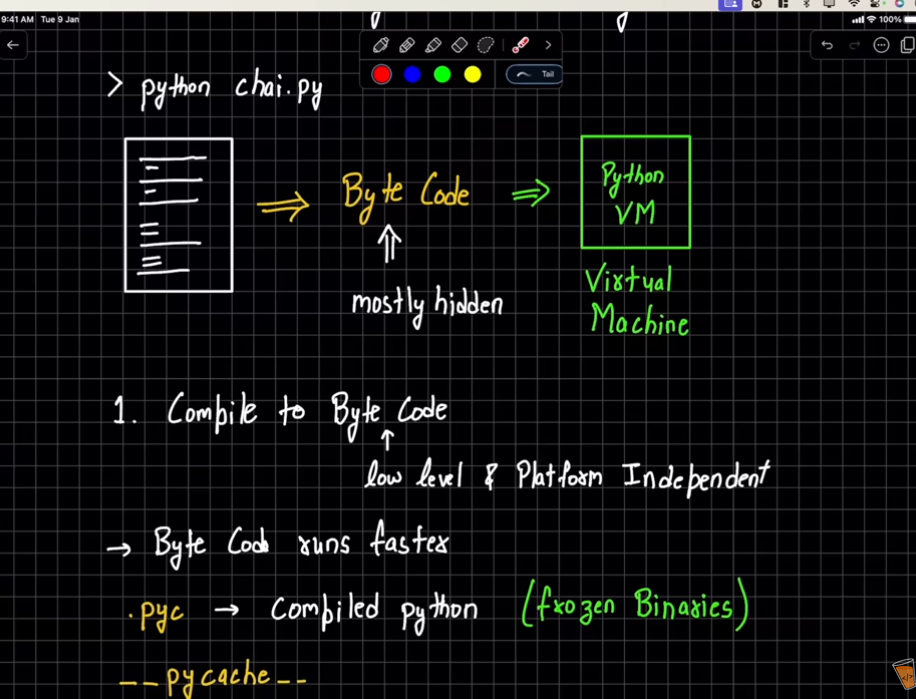

### CHECK VERSION

`python3 --version`

### Naming convenstion

When naming Python files, variables, or functions, always use snake_case.

=> Use lowercase letters
=> Use underscores \_ between words

### Running a Python File

**A=>** Go to the right-side file explorer (such as in VS Code).
Right-click the Python file you want to run.
Select "Run Python File in Terminal" or the equivalent option for your editor.

**B=>** Open your terminal and type

`python <filename>.py`

### working of python

